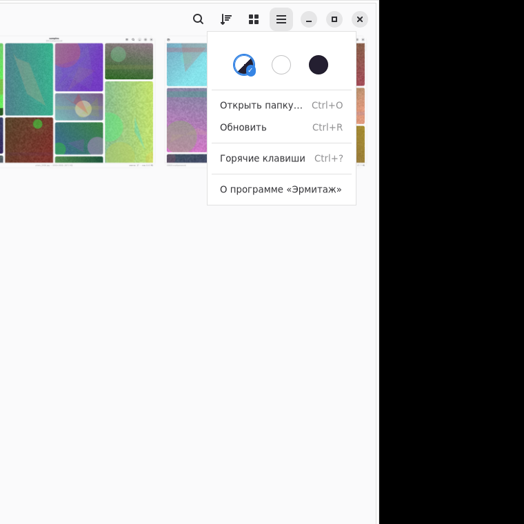
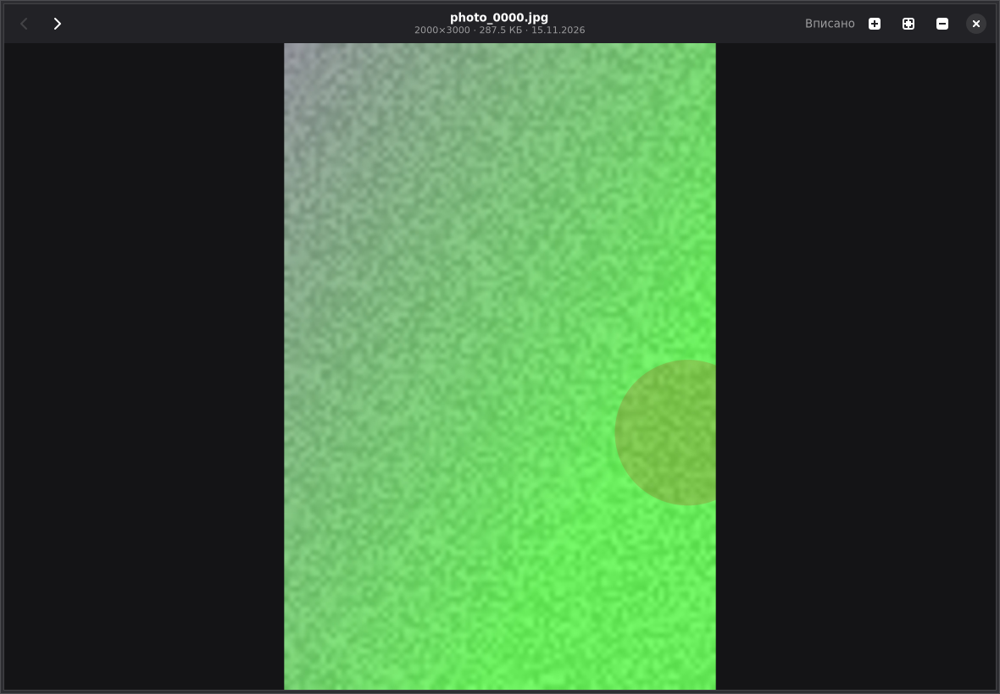

<h1 align="center">Эрмитаж · Hermitage</h1>

<p align="center">
  <em>Быстрая галерея изображений для Linux на GTK 4 + libadwaita<br>
  с настоящей masonry-сеткой и мгновенным открытием больших медиатек</em>
</p>

<p align="center">
  <a href="LICENSE"></a>
  
  
  
  <a href="flatpak/io.github.hermitage.Hermitage.json"></a>
  
</p>

<p align="center">
  
</p>

---

**Эрмитаж** открывает каталог с фотографиями плотной сеткой, где плитки
сохраняют пропорции снимков, — как в Pinterest, Google Images или в галерее
macOS. Рассчитан на медиатеки в десятки тысяч файлов: каталог из 50 000
изображений индексируется за секунду, первые плитки появляются через 0,2 с, а в
памяти живут два-три десятка виджетов вместо пятидесяти тысяч.

Интерфейс — чистокровный Adwaita без самодельных панелей: шапка с поиском,
сортировкой и размером плиток, переключатель оформления из трёх кружков,
контекстное меню для действий над файлами. Строки GTK и libadwaita
переведены на русский.

## Возможности

**Сетка и навигация**

* Masonry-раскладка с сохранением пропорций; колонки пересчитываются при любом
  изменении размера окна — от одной колонки до любой ширины.
* Виртуализация: виджеты существуют только для видимой области и overscan,
  освободившиеся плитки уходят в пул и переиспользуются.
* Клавиатура: стрелки ходят по визуальному соседству, `Enter`/`Space` открывают
  изображение (а не папку), `Ctrl` + колесо мыши меняет размер плиток.
* Поиск по имени файла с задержкой ввода и четыре режима сортировки.

**Миниатюры**

* Декодирование сразу в нужном масштабе: `GdkPixbuf.PixbufLoader.set_size()`
  заставляет JPEG-загрузчик сжаться в 1/2–1/8 **во время** декодирования.
* Двухуровневый кэш: файлы на диске (`~/.cache/hermitage/thumbs-v2`) и
  LRU-кэш готовых `Gdk.Texture` в памяти (192 МБ по умолчанию).
* Плотная сетка бакетов (~10 %) — текстуру не приходится дожимать при
  отрисовке, поэтому плитки резкие, а не «мыльные».
* Собственный парсер заголовков JPEG/EXIF, PNG, GIF, WebP, BMP — пропорции
  известны до декодирования, EXIF-ориентация учитывается.

**Просмотр**

* Полноэкранный просмотрщик: масштаб «вписать / 1:1 / ±25 %», панорамирование
  перетаскиванием, переход стрелками, `F11`.
* Масштаб считается матрицей `Gsk.Transform` — без пересчёта раскладки.

**Интерфейс по гайдлайнам GNOME**

* Нижней панели состояния нет: счётчик изображений и выделение — в подзаголовке
  окна, сведения о файле — на самой плитке при наведении.
* Сортировка и размер плиток — отдельные кнопки-меню в шапке (как в Nautilus).
* Оформление — штатный `Adw.ToggleGroup` из трёх кружков «система / светлая /
  тёмная» с акцентной галочкой, как в GNOME Builder.
* Приветственный `Adw.StatusPage` при первом запуске: приложение не открывает
  каталог, из которого его запустили.
* Помнит последнюю папку, сортировку, размер плиток, оформление и размер окна.

## Скриншоты

| Тёмное оформление | Переключатель оформления |
|---|---|
|  |  |

| Просмотрщик | Каталог на 50 000 фотографий |
|---|---|
|  |  |

## Установка

### Flatpak (один файл)

```bash
flatpak install ./Hermitage-1.0.0-x86_64.flatpak
flatpak run io.github.hermitage.Hermitage
```

Файл `.flatpak` открывается двойным кликом в GNOME Software, KDE Discover или
«Центре приложений». В бандл вшита ссылка на Flathub, поэтому недостающий
рантайм установщик предложит скачать сам.

### AppImage (без установки)

```bash
chmod +x Hermitage-x86_64.AppImage
./Hermitage-x86_64.AppImage ~/Фото
```

Внутри уже лежат Python, GTK 4 и libadwaita — на машине нужны только glibc,
драйверы и шрифты.

### Из исходников

Требуется Python 3.10+, GTK 4.10+ (проверено на 4.24), libadwaita 1.4+
(проверено на 1.10) и PyGObject.

```bash
./run.sh                # последняя открытая папка или приветственный экран
./run.sh ~/Фото         # конкретный каталог
```

Установка в систему:

```bash
meson setup build --prefix=/usr/local
meson install -C build          # появится команда hermitage и .desktop-файл
```

Демонстрационный набор изображений:

```bash
python3 tools/make_samples.py samples 200
./run.sh samples
```

## Сборка пакетов

```bash
./tools/build-appimage.sh        # → dist/Hermitage-x86_64.AppImage (~33 МБ)
./tools/build-flatpak.sh         # → dist/Hermitage-1.0.0-x86_64.flatpak (~130 КБ)
./tools/build-flatpak.sh --from-git   # ровно так, как собирает Flathub
./tools/lint-flatpak.sh          # манифест + AppStream + .desktop линтерами
```

Манифестов два: `flatpak/…json` собирает из рабочего каталога (для повседневной
сборки бандла), `flatpak/flathub/…json` — из git по тегу с зафиксированным
коммитом, это версия для отправки в Flathub. Пошаговая инструкция —
[`flatpak/flathub/README.md`](flatpak/flathub/README.md), переименование под свой
аккаунт — `./tools/setup-app-id.sh io.github.<логин>.Hermitage`.

## Производительность

Замеры на медиатеке из 50 400 файлов (2 vCPU, GTK 4.24, cairo-рендер):

| Показатель | Значение |
|---|---|
| Индексация каталога | 1,0 с (≈49 000 файлов/с) |
| Появление первых плиток | 0,20 с |
| Полная раскладка 50 000 | 20 мс |
| Прокрутка (медиана / p95) | 1,2 / 10 мс |
| Новая миниатюра (пустой кэш) | 4,5 мс на файл |
| Миниатюра из дискового кэша | 0,3 мс |
| Память (RSS) | ≈200 МБ |

Собственный бенчмарк:

```bash
DISPLAY=:0 PYTHONPATH=src python3 tools/bench.py ~/Фото
HERMITAGE_TIMING=1 ./run.sh ~/Фото      # замеры индексации в консоли
```

## Горячие клавиши

| Клавиши | Действие |
|---|---|
| `Ctrl+O` | открыть каталог |
| `Ctrl+R`, `F5` | пересканировать |
| `Ctrl+F` | поиск по имени файла |
| `←` `→` `↑` `↓` | к соседней плитке по визуальному соседству |
| `Enter`, `Space` | открыть изображение |
| `Ctrl+A` / `Esc` | выбрать все / снять выбор |
| `Ctrl` + колесо, `Ctrl+±` | размер плиток |
| `Ctrl+Shift+C` | скопировать путь |
| `Ctrl+Shift+O`, `Ctrl+Enter` | открыть в приложении по умолчанию / в просмотрщике |
| `Ctrl+D` | светлое/тёмное оформление |
| `Ctrl+?` | окно подсказок |
| В просмотрщике | `←` `→`, `0` (вписать), `1` (1:1), `+` `-`, `F11`, `Esc` |

## Как это устроено

* **Раскладка.** `masonry.py` — контейнер с виртуализацией: один линейный проход
  по элементам вычисляет позиции, видимый диапазон определяется по прокрутке,
  плитки берутся из пула. Плитка (`tile.py`) рисуется вручную в `GtkSnapshot`:
  скруглённый клип + одна текстура + подпись при наведении.
* **Миниатюры.** `thumbnails.py` — пул потоков, декодирование в нужном масштабе,
  дисковый кэш по ключу «путь + mtime + размер + бакет», LRU текстур в памяти.
  GTK-объекты создаются только в главном потоке.
* **Метаданные.** `imageinfo.py` читает заголовки файлов, чтобы знать размеры до
  декодирования — сетка строится, не открывая изображения.
* **Настройки.** GSettings (`io.github.hermitage.Hermitage`), с откатом на
  JSON-файл, если схема не установлена.

```
src/masonry_gallery/
├── application.py    # Adw.Application, действия, акселераторы, CSS
├── window.py         # окно: шапка, поиск, сортировка, DnD, подзаголовок
├── masonry.py        # masonry-контейнер с виртуализацией и пулом плиток
├── tile.py           # плитка: отрисовка в GtkSnapshot
├── thumbnails.py     # пул потоков, масштабированное декодирование, кэш
├── imageinfo.py      # быстрый разбор заголовков изображений
├── model.py          # Item, сканирование каталога, фильтр и сортировка
├── viewer.py         # просмотрщик: масштаб на Gsk.Transform
├── theme_switcher.py # три кружка оформления на Adw.ToggleGroup
├── palette.py        # цвета плиток из Adw.StyleManager
├── shortcuts.py      # окно горячих клавиш
├── gtktext.py        # русские подписи вместо строк из каталогов GTK
├── settings.py       # GSettings или JSON-файл
└── style.css
data/                 # .desktop, метаданные AppStream, иконка, схема GSettings
flatpak/              # манифесты: локальный и для Flathub
tools/                # сборка AppImage/Flatpak, бенчмарк, линтеры, демо-набор
docs/                 # скриншоты для README и метаданных
```

## Ограничения

* Только изображения: миниатюр для видео и редактирования нет.
* Нет живой подписки на изменения каталога (`Gio.FileMonitor`) — обновление по `F5`.
* AppImage везёт с собой Python и GTK, но не glibc и драйверы — образ не
  запустится на дистрибутиве старше сборки.
* Сортировка и фильтр пересобирают массив целиком: для 50 000 файлов это
  десятки миллисекунд, для миллиона понадобилось бы инкрементальное обновление.

## Участие и лицензия

Issues и pull request'ы приветствуются. Код под [MIT](LICENSE); название
«Эрмитаж» (Hermitage) — отсылка к музею, а не к чему-то ещё.
