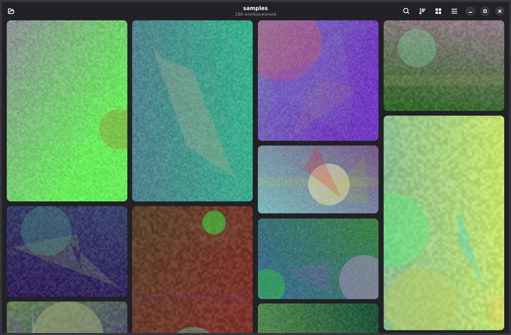
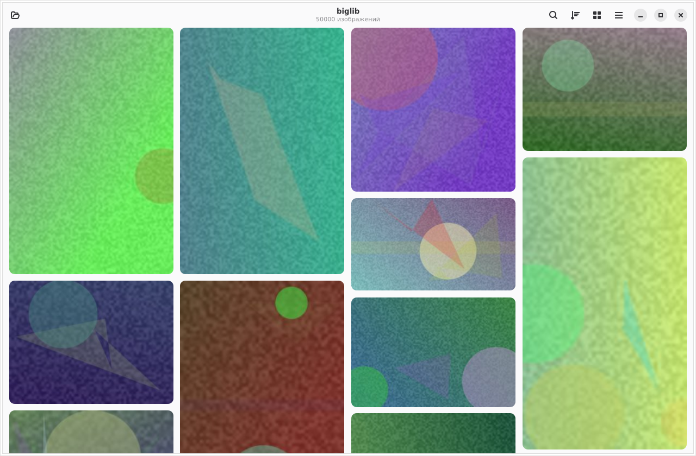
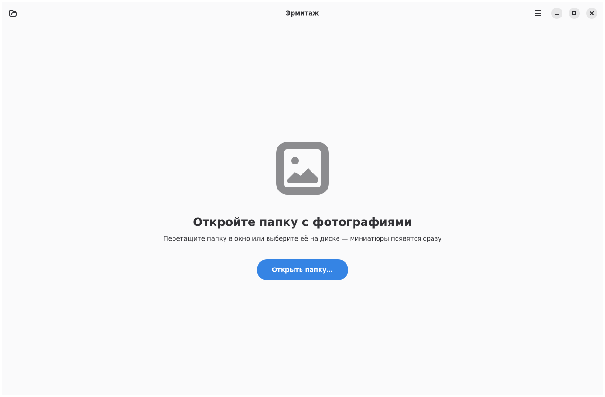

# Эрмитаж

Быстрая галерея изображений для Linux на **GTK 4 + libadwaita** с настоящей
**masonry-сеткой**: плитки сохраняют пропорции снимков, как в Pinterest или
Google Images.

Рассчитана на медиатеки в **десятки тысяч фотографий**: каталог из 50 000 файлов
индексируется за ~1.3–2.6 секунды, первые плитки появляются на экране через
0.2–0.3 секунды, в памяти живут 20–60 виджетов вместо 50 000.


| Тёмная тема | Просмотрщик |
|---|---|
|  |  |

Каталог на 50 000 фотографий:



Приветственный экран — то, что видно при первом запуске, пока папка не выбрана:



---

## Возможности

* **Masonry-сетка** с сохранением пропорций; колонки подстраиваются под ширину
  окна при каждом изменении размера.
* **Виртуализация**: виджеты существуют только для видимой области + overscan,
  освободившиеся плитки уходят в пул и переиспользуются.
* **Асинхронные миниатюры**: пул потоков, декодирование сразу в нужном масштабе,
  двухуровневый кэш (диск + GPU-текстуры в памяти). Бакеты размеров идут с шагом
  ~10 %, поэтому текстура почти совпадает с размером плитки и её не приходится
  дожимать при отрисовке (именно этот лишний шаг сжатия и давал ощущение
  «мыла»).
* **Поиск по имени файла** с задержкой ввода, сортировка (имя / дата / размер /
  перемешивание), четыре размера плиток (`Ctrl` + колесо мыши).
* **Просмотрщик**: масштаб `вписать / 1:1 / ±25 %`, панорамирование перетаскиванием,
  переход стрелками, `F11` — полный экран. Масштаб считается матрицей
  `Gsk.Transform`, без пересчёта раскладки.
* **Выделение**: один клик, `Ctrl`+клик, `Shift`+клик (диапазон), `Ctrl+A`;
  всё, что делается с конкретными файлами, — в контекстном меню.


* **Оформление — штатный libadwaita-переключатель**: три кружка
  «система / светлая / тёмная» (`Adw.ToggleGroup` из трёх `Adw.Toggle`) прямо в
  главном меню, как в GNOME Builder; выбранный обведён акцентом и отмечен
  галочкой. Системный акцентный цвет учитывается, `Ctrl+D` — быстрый переход
  между светлой и тёмной.
* **Drag & drop** каталога в окно, `Ctrl+O` — выбор каталога, `F5` — пересканировать.
* Поддержка JPEG, PNG, WebP, GIF, BMP, TIFF, AVIF, HEIC, JXL, SVG
  (что умеет gdk-pixbuf) и учёт **EXIF-ориентации**.
* **Помнит состояние**: последняя папка, сортировка, размер плиток, тема и
  размер окна сохраняются в GSettings (`io.github.ermitage.Ermitage`).
* **Адаптивный интерфейс**: окно сжимается до 360 px, сетка перестраивается от
  одной колонки до любой ширины, лишние кнопки шапки убираются через
  `Adw.Breakpoint`.

## Интерфейс по гайдлайнам GNOME

* **Нижней панели состояния нет.** Число изображений и (только при групповом
  выборе) «выбрано N» показывает подзаголовок окна, сведения о файле — сама плитка при наведении. Так сделано
  в Nautilus, Files, Loupe: контент занимает всё окно, ничего не «подвешено»
  снизу.
* **Приветственный экран вместо пустой сетки.** Пока папка не открыта,
  показывается `Adw.StatusPage` с кнопкой «Открыть папку…» — приложение не
  открывает каталог, из которого его запустили. При следующем запуске
  открывается последняя папка (её помнит GSettings).
* **Сортировка и размер плиток — отдельные кнопки-меню в шапке** (как в
  Nautilus), с нативными radio-пунктами и состоянием в действиях
  `win.sort` / `win.thumb-size`.
* **Главное меню — только уровень приложения**: переключатель оформления,
  открыть папку, обновить, горячие клавиши, «О программе». Действия над файлами
  (открыть, скопировать путь, показать в файловом менеджере, выбор) живут
  исключительно в контекстном меню.
* **`Enter` и `Space` открывают изображение**, а не папку: клавиши ловятся
  контроллером в фазе `CAPTURE`, поэтому кнопка «Открыть папку» в шапке их не
  перехватывает. Если фокус явно стоит на кнопке, `Enter`/`Space` нажимают её —
  как и положено в GTK.
* **Оформление — `Adw.ToggleGroup`, а не пункт меню с галочкой.** Три кружка
  вставлены в `Gtk.PopoverMenu` как «custom»-виджет (`popover.add_child`),
  активное состояние живёт в действии `app.color-scheme` (`system` / `light` /
  `dark`) и в GSettings. Семантика — из документации libadwaita: «система» →
  `PREFER_LIGHT`, «светлая» → `FORCE_LIGHT`, «тёмная» → `FORCE_DARK`;
  `Ctrl+D` переключает светлую/тёмную, и переключатель это отражает.
* **Русские подписи целиком**: строки, которые GTK и libadwaita берут из своих
  каталогов («Shortcuts», «Details», «Legal», «Show All»), подменяются
  вручную — см. `gtktext.py`.
* **Значок приложения** нарисован по HIG: полотно 128×128, скруглённый квадрат
  на всю площадь, простая геометрия masonry-сетки без текста и мелких деталей —
  читается и в 16 px.

## Запуск

Из исходников, без установки:

```bash
./run.sh                # последняя открытая папка или приветственный экран
./run.sh ~/Фото         # конкретный каталог
```

Требуется Python 3.10+, GTK 4.10+ (проверено на 4.18), libadwaita 1.4+
(проверено на 1.7), PyGObject.

Демо-набор для проверки:

```bash
python3 tools/make_samples.py samples 200   # процедурные «фотографии» разных пропорций
./run.sh samples
```

Установка в систему:

```bash
meson setup build --prefix=/usr/local
meson install -C build          # появится команда `ermitage` и .desktop-файл
```

## Flatpak

Манифест лежит в `flatpak/io.github.ermitage.Ermitage.json`, всё собирается
скриптом:

```bash
./tools/build-flatpak.sh          # сборка + установка в профиль пользователя
./tools/build-flatpak.sh --run    # и сразу запуск
flatpak run io.github.ermitage.Ermitage ~/Фото
```

Что внутри манифеста:

* рантайм `org.gnome.Platform`/`org.gnome.Sdk` **48** — в нём уже есть GTK 4,
  libadwaita и PyGObject, поэтому приложению нечего компилировать: сборка
  занимает секунды и не требует сети, кроме первого скачивания рантайма
  (`flatpak remote-add --if-not-exists --user flathub
  https://flathub.org/repo/flathub.flatpakrepo`);
* установка через `meson` с префиксом `/app`: пакет → `site-packages`,
  команда `ermitage` → `/app/bin`, `.desktop`, метаданные AppStream, иконка и
  схема GSettings — по своим местам (`gnome.post_install` компилирует схему и
  кэш иконок);
* `finish-args`: Wayland и X11, `--device=dri`, чтение всей файловой системы
  (`--filesystem=host:ro`) — галерее нужно показывать снимки откуда угодно,
  но запись ей не нужна; плюс доступ к gvfs для «Показать в файловом менеджере».

Проверить сборку без установки:

```bash
flatpak-builder --user --force-clean --repo=dist/flatpak-repo build-flatpak \
  flatpak/io.github.ermitage.Ermitage.json
flatpak build-export dist/flatpak-repo build-flatpak
```

Оговорка: в этом окружении `flatpak`/`flatpak-builder` не установлены, поэтому
манифест проверен статически (валидный JSON, реальная установка `meson setup
--prefix=/app && ninja install` в подставной корень, запуск установленного
пакета) — саму сборку образа выполняет `tools/build-flatpak.sh` на машине с
Flatpak.

## AppImage (проверить «вживую», без установки)

Готовый самодостаточный файл, в котором уже лежат Python, GTK и libadwaita:

```bash
tools/build-appimage.sh            # → dist/Ermitage-x86_64.AppImage, ~33 МБ
chmod +x dist/Ermitage-x86_64.AppImage
./dist/Ermitage-x86_64.AppImage ~/Фото
```

Собирается один раз (нужны системные GTK4, libadwaita, PyGObject, `curl`,
`squashfs-tools`; `appimagetool` скачивается автоматически в `build/`).
Сжатие можно сменить: `APPIMAGE_COMPRESSION=xz tools/build-appimage.sh`.

**Что внутри:** CPython 3.13 со стандартной библиотекой (без тестов, `idlelib`,
`tkinter`), PyGObject и все typelib'ы, GTK 4 + libadwaita и замыкание их
зависимостей по `ldd`, загрузчики gdk-pixbuf (JPEG/PNG/WebP/TIFF/AVIF/SVG),
GSettings-схемы, символические иконки Adwaita (без 12 МБ курсоров) и русские
`.mo` для GTK/libadwaita.

Настройки внутри AppImage тоже сохраняются: `AppRun` выставляет
`GSETTINGS_BACKEND=keyfile` (dconf в образе нет и не нужен), поэтому последняя
папка, сортировка, размер плиток и тема переживают перезапуск.

**Чего внутри нет** (и правильно): glibc, драйверы GL/Mesa, `libwayland-egl` —
это берётся у системы. Поэтому `AppRun` по умолчанию выставляет
`GSK_RENDERER=cairo` (не зависит от драйверов) и `GTK_MEDIA=none` (видео
галерее не нужно). Оба значения можно переопределить из окружения:

```bash
GSK_RENDERER=ngl ./dist/Ermitage-x86_64.AppImage ~/Фото
```

**Замеры на этом образе** (2 vCPU, 1 ГБ RAM, X11): от запуска `.AppImage` до
первых плиток — 1.2 с (включая распаковку squashfs); библиотека на 50 000
файлов — индексация 2.2 с, RSS 207 МБ, листание без подтормаживаний.

Ограничения образа: x86_64 и glibc не старше той, на которой собирали
(Debian 13 / glibc 2.41). Для более старых дистрибутивов собирайте AppImage на
них же или используйте Flatpak.

## Почему это быстро

Всё приложение — это четыре решения, принятых из-за больших библиотек.

### 1. Своя masonry-раскладка на `Gtk.Widget`, а не `Gtk.GridView`

`Gtk.FlowBox` и `Gtk.GridView` требуют одинаковых ячеек, колонки из `Gtk.Box`
не умеют переиспользовать виджеты. Поэтому `MgMasonryView` — свой контейнер:

* один линейный проход по элементам; колонка выбирается через мини-кучу
  `heapq` (O(log k) при k колонках);
* высота плитки = `ширина_колонки / aspect_ratio`, где aspect берётся из
  заголовка файла — **ничего не декодируется** для раскладки;
* пропорции лежат отдельным списком `float` (`GalleryModel.aspects`), а внутри
  колонок хранятся только индексы: создание кортежей на каждый из 50 000
  элементов удваивало стоимость пересчёта (60 мс → 25 мс);
* видимая область ищется `bisect` по Y-координатам колонок — O(log n + k);
* поиск элемента по пути — словарь, O(1) вместо линейного `index()`.

### 2. Виртуализация и пул виджетов

На 50 000 фотографий в памяти живут **25–30 плиток** (`Tile`), а не 50 000.
При прокрутке плитки не создаются, а перепривязываются к новым элементам;
незавершённые запросы миниатюр отменяются.

Плитка — это `Gtk.Widget` **без детей и без CSS**: вся отрисовка в
`do_snapshot()` — скруглённый клип + одна текстура + (по наведению) подпись
через Pango. 2–4 узла render node на плитку.

### 3. Миниатюры: декодирование сразу в нужном масштабе

* `GdkPixbuf.PixbufLoader.set_size()` заставляет JPEG-загрузчик сжаться в
  1/2, 1/4 или 1/8 **во время декодирования**; пропорции считаются по заголовку,
  чтобы картинку не сплющило (это не «максимум», а точный размер — важная деталь).
* Кэш на диске (`~/.cache/masonry-gallery/thumbs-v2`, бакеты 160…1024 px с
  шагом ~10 %): повторный показ каталога вообще не декодирует файлы. Плотная
  сетка бакетов важна не только для кэша: готовую текстуру не приходится
  сжимать при отрисовке, поэтому плитки выглядят резче (замер: 290-пиксельная
  плитка получала текстуру 384 px и теряла ~7 % детализации на лишнем
  линейном шаге).
* LRU-кэш `Gdk.Texture` в памяти (по умолчанию 192 МБ, `ERMITAGE_CACHE_MB`):
  перерисовка — это только создание render nodes.
* Работа с пикселями — в пуле потоков, GTK-объекты создаются только в главном
  потоке. Пока задача стоит в очереди, она проверяет, нужна ли ещё.

### 4. Индексация: свой парсер заголовков

`GdkPixbuf.get_file_info()` — это ~115 мкс на файл (создание загрузчика,
поднятие модулей), то есть ~6 секунд на 50 000 фотографий. `imageinfo.py`
разбирает первые килобайты сам (JPEG + EXIF-ориентация, PNG, GIF, WebP, BMP),
~15 мкс на файл, а для остальных форматов откатывается на gdk-pixbuf.

Порции результатов отдаются главному потоку через рукопожатие (`Event`):
индексатор ждёт, пока UI отрисует предыдущую порцию, поэтому очередь не растёт,
окно остаётся отзывчивым, а память — плоской.

### Замеры

Стенд: **2 vCPU, 1 ГБ RAM, программный рендеринг GSK (`GSK_RENDERER=cairo`)** —
худший из возможных случаев, на реальной машине с GPU всё заметно бодрее.
Каталог: **50 400 файлов** (≈2000×3000 и 4000×2250).

| Операция | Результат |
|---|---|
| Индексация 50 000 файлов (скан + заголовки) | **1.3–2.6 с** (≈20–38 тыс. файлов/с) |
| Первые плитки на экране | **0.2–0.3 с** |
| Полная раскладка 50 000 элементов | **20–40 мс** |
| Догрузка порции из 240 элементов | **0.1–0.3 мс** |
| Поиск видимого диапазона | **≈4 мкс** |
| Шаг курсора стрелкой (O(log n)) | **≈12 мкс** |
| Один шаг прокрутки (перепривязка + allocation) | медиана **0.8–1.5 мс**, p95 **8–12 мс** |
| Живых виджетов-плиток на 50 000 файлов | **25–29** |
| Миниатюра, пустой кэш | **6–9 мс** (110–160 шт/с) |
| Миниатюра из дискового кэша | **0.5–1.3 мс** |
| Миниатюра из RAM-кэша | **≈0 мс** |
| RSS после индексации 50 000 файлов | **≈150 МБ** (включая ~126 МБ Python+GTK) |
| RSS при активном скролле | плато ≈ бюджет кэша текстур |

Воспроизвести:

```bash
DISPLAY=:0 PYTHONPATH=src python3 tools/bench.py ~/Фото
ERMITAGE_TIMING=1 ./run.sh ~/Фото     # замеры индексации в консоли
```

## Горячие клавиши

| Клавиши | Действие |
|---|---|
| `Ctrl+O` | открыть каталог |
| `Ctrl+R`, `F5` | пересканировать |
| `Ctrl+F` | поиск по имени файла |
| `←` `→` `↑` `↓` | перейти к соседней плитке (по визуальному соседству) |
| `Enter`, `Space` | открыть изображение в просмотрщике |
| `Ctrl+A` / `Esc` | выбрать все / снять выбор |
| `Ctrl` + колесо, `Ctrl+±` | размер плиток |
| `Ctrl+Shift+C` | скопировать путь |
| `Ctrl+Shift+O`, `Ctrl+Enter` | открыть в приложении по умолчанию / в просмотрщике |
| `Ctrl+D` | тёмная/светлая тема |
| `Ctrl+?` | окно подсказок |
| В просмотрщике: `←` `→`, `0` (вписать), `1` (1:1), `+` `-`, `F11`, `Esc` | навигация и масштаб |

## Структура проекта

```
src/masonry_gallery/
├── application.py   # Adw.Application, действия, акселераторы, CSS
├── main.py          # точка входа `ermitage [КАТАЛОГ]`
├── window.py        # главное окно: заголовок, поиск, сортировка, DnD, статус
├── masonry.py       # masonry-контейнер с виртуализацией и пулом плиток
├── tile.py          # плитка: ручная отрисовка в GtkSnapshot
├── palette.py       # цвета плиток из Adw.StyleManager (тёмная тема, акцент)
├── thumbnails.py    # пул потоков, декодирование в масштабе, кэш диск+RAM
├── imageinfo.py     # быстрый парсер заголовков (JPEG/EXIF, PNG, GIF, WebP, BMP)
├── model.py         # Item, сканирование каталога, фильтр/сортировка, порции
├── viewer.py        # просмотрщик: ImageStage с Gsk.Transform
├── shortcuts.py     # окно горячих клавиш
├── gtktext.py       # русские подписи вместо строк из каталогов GTK/libadwaita
├── settings.py      # GSettings (или JSON-файл, если схема не установлена)
├── theme_switcher.py # три кружка оформления на Adw.ToggleGroup (как в Builder)
└── style.css        # минимальный CSS (плитки рисуются в Gsk)
data/                # .desktop, метаданные AppStream, иконка, схема GSettings
tools/               # make_samples.py, bench.py, build-appimage.sh, build-flatpak.sh
flatpak/             # манифест Flatpak (org.gnome.Platform 48)
dist/                # собранный AppImage (после tools/build-appimage.sh)
```

## Ограничения и что дальше

* Нет миниатюр для видео и нет редактирования — это просмотрщик фотографий.
* Нет «живой» подписки на изменения каталога (`Gio.FileMonitor`) — обновление по `F5`.
* Панорамирование в просмотрщике — перетаскиванием; инерции нет.
* AppImage тащит за собой только Python/GTK: GL-драйверы и glibc берутся у
  системы, поэтому образ не запустится на дистрибутиве старше сборки.
* Сортировка и фильтр пересобирают массив (`O(n log n)` разово) — для 50 000 это
  десятки миллисекунд, но при миллионе файлов имело бы смысл инкрементальное
  обновление и `Gtk.FilterListModel`.

## Лицензия

MIT. См. [LICENSE](LICENSE).
